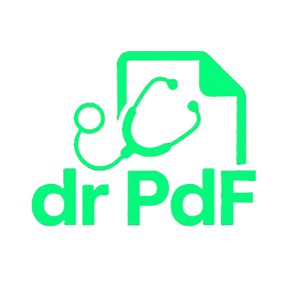

# 🩺 dr.PdF: Intelligent Document Assistant



**dr.PdF** adalah aplikasi web berbasis *Generative AI* yang dirancang untuk membedah dokumen PDF secara otomatis dan mengubah dokumen statis menjadi materi belajar interaktif berupa ringkasan, kuis pilihan ganda, serta kartu hafalan (*flashcard*). Proyek ini awalnya dikembangkan sebagai Tugas Portofolio Akhir Informatika Kelas XII.

## ✨ Fitur Utama
* **📂 Ekstraksi Teks PDF:** Membaca dan mengekstrak teks dari dokumen PDF (hingga 200MB) menggunakan `PyPDF2`.
* **📝 Generator Ringkasan Cerdas:** Menyusun intisari dokumen dalam format Paragraf Singkat, Poin-Poin (*Bullet Points*), Tabel Perbandingan, atau Analogi Sederhana dengan opsi instruksi tambahan.
* **🧠 Ujian Kompetensi (Quiz Generator):** Menghasilkan soal latihan pilihan ganda otomatis (5 opsi A–E) berdasarkan tingkat kesulitan (*Mudah*, *Menengah*, *Sulit/HOTS*) lengkap dengan perhitungan skor.
* **🎮 Mode Hafalan (Active Recall Flashcard):** Terdiri dari 3 tahap interaktif (*Setup*, *Study*, dan *Evaluasi Matching Game*) untuk membantu menghafal istilah dan definisi penting.
* **📥 Ekspor Materi (.txt):** Unduh hasil ringkasan, soal beserta kunci jawaban, dan daftar kartu hafalan untuk dipelajari secara *offline*.

## 🛠️ Tech Stack
* **Frontend & UI:** [Streamlit](https://streamlit.io/) + Custom CSS (*Animated Gradient*, *Glassmorphism*)
* **AI Engine:** Google Gemini API (`google-generativeai` - `gemini-flash-latest`)
* **PDF Parsing:** `PyPDF2`

## 🚀 Cara Menjalankan secara Lokal

1. **Clone repositori ini:**
   ```bash
   git clone [https://github.com/rafarahman19/dr-pdf.git](https://github.com/rafarahman19/dr-pdf.git)
   cd dr-pdf